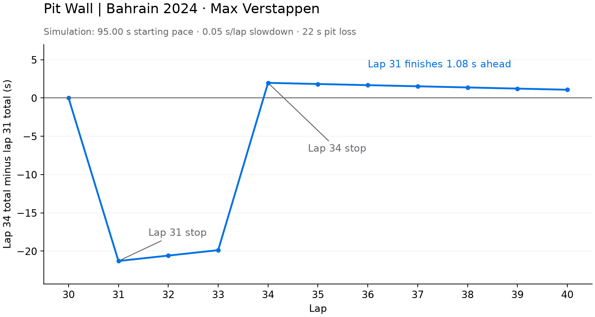

# Pit Wall

Compare two F1 pit-stop choices: change tires before lap 31 or wait until lap 34. Adjust replacement-tire pace and slowdown to see which choice is faster over laps 31–40.

This case study uses Max Verstappen's 2024 Bahrain Grand Prix data from [OpenF1](https://openf1.org/). I built the data cleaning, linear regression, strategy simulation, and Streamlit app.

**Tools:** Python, Streamlit, pandas, Matplotlib, and requests.

## Example output



With the committed model and default assumptions:

| Stop before | Time over laps 31–40 |
| --- | ---: |
| Lap 31 | 974.25 s |
| Lap 34 | 975.33 s |

Lap 31 is **1.08 seconds faster in this simulation**. This is a comparison of assumed strategies, not a measured race result. Inspect the [lap-by-lap CSV](examples/default_strategy.csv) or regenerate both files with `python generate_example.py`. No race-data download is needed.

## Run the app

Use **Python 3.11 or newer**. On macOS or Linux:

```bash
git clone https://github.com/aakarsh-g7/pit-wall.git
cd pit-wall
python3 -m venv .venv
source .venv/bin/activate
python -m pip install -r requirements.txt
python -m streamlit run app.py
```

On Windows, use PowerShell:

```powershell
git clone https://github.com/aakarsh-g7/pit-wall.git
cd pit-wall
py -m venv .venv
.\.venv\Scripts\Activate.ps1
python -m pip install -r requirements.txt
python -m streamlit run app.py
```

Open the local URL printed in the terminal. Press **Ctrl+C** to stop the app. The saved model is included, so the app runs without fetching OpenF1 data.

## What the sliders mean

| Slider | Range; default | What it changes |
| --- | --- | --- |
| **Starting lap time** | 94–97 s; 95 s | First lap time on replacement tires, before pit loss. Lower values favor an earlier stop. |
| **Slowdown per lap** | 0–0.20 s; 0.05 s | Time added for each extra lap on replacement tires. Higher values favor waiting. |

For example, 95 s starting pace and 0.05 s slowdown give replacement-tire times of **95.00, 95.05, 95.10 s**, and so on. The same settings apply to both strategies. Their pit laps stay fixed.

The choice changes with the assumptions:

| Starting pace | Slowdown per lap | Faster strategy | Advantage |
| ---: | ---: | --- | ---: |
| 94.00 s | 0.00 s | Lap 31 | 5.28 s |
| 95.00 s | 0.05 s | Lap 31 | 1.08 s |
| 97.00 s | 0.20 s | Lap 34 | 8.52 s |

These values use the committed model. They demonstrate sensitivity to the inputs, not uncertainty bounds.

## Reading the UI

- **Estimated time:** total for each strategy over ten laps, shown as minutes:seconds. Lower is better.
- **Time difference:** lap-34 cumulative time minus lap-31 cumulative time. Above zero favors lap 31; below zero favors lap 34.
- **Chart jumps:** each strategy adds a fixed 22-second pit loss on its pit lap. Both pay it once, so this identical cost cancels from the final difference.
- **How it works:** explains the assumptions and limits.
- **Lap-by-lap estimates:** inspect lap times, running totals, and the gap. Download the current estimates as CSV.

## Data and model

[explore.py](explore.py) downloads the race session, driver 1's laps, and tire stints from OpenF1. It removes missing lap times, the opening lap, pit-out laps, and laps just before tire changes.

It selects the first hard-tire stint using the downloaded stint boundaries. A straight line is fitted to its first **12 cleaned laps**:

`old-tire lap time = intercept + slope × race lap number`

Later cleaned laps in that stint form the test set. The script compares mean absolute error (MAE, in seconds) against a baseline that always predicts the training median. The current repository includes the fitted coefficients, but no saved source data or historical test results. No prediction-accuracy score is claimed here.

The simulation uses that trend until each stop. Replacement-tire times come from the sliders, not from a second fitted model. The app, analysis, and saved example share [simulation.py](simulation.py).

## Rerun the analysis

With the environment active:

```bash
python check_connection.py
python explore.py --no-show
python generate_example.py
```

This requires OpenF1 access. `explore.py` replaces `model_parameters.json` and saves the following in `outputs/`:

- Downloaded lap and stint tables, cleaned laps, and stint summaries.
- Test-lap predictions and baseline predictions.
- `analysis_summary.json` with the session query, download time, training/test lap numbers, coefficients, assumptions, and both MAEs.
- `race_pace.png`, a chart of cleaned lap times by stint.

Run without `--no-show` to also open the race-pace chart. `outputs/` is ignored by Git. Review changed coefficients and regenerate the example before committing an analysis update.

## Project files

| File | Purpose |
| --- | --- |
| [app.py](app.py), [styles.css](styles.css), [.streamlit/config.toml](.streamlit/config.toml) | Streamlit UI and styling |
| [simulation.py](simulation.py) | Shared strategy calculation and CSV export |
| [explore.py](explore.py) | Download, clean, fit, evaluate, and save analysis outputs |
| [model_parameters.json](model_parameters.json) | Committed slope and intercept used by the app |
| [generate_example.py](generate_example.py), [examples/](examples/) | Reproduce and inspect the default output |
| [check_connection.py](check_connection.py) | Check the OpenF1 connection |
| [requirements.txt](requirements.txt), [tests/](tests/) | Pinned direct dependencies and calculation/UI checks |

Run the checks after installing dependencies:

```bash
python -m unittest discover -s tests -v
```

GitHub Actions runs them on Python 3.12 and 3.14, including the default UI and both slider extremes.

## Limits and next steps

This is a retrospective ten-lap comparison for one driver and race. The fitted slope reflects overall pace changes, including fuel load and race conditions. It does **not** isolate tire degradation. Replacement-tire pace, slowdown, and pit loss are assumptions.

The model excludes traffic, tire warmup, safety cars, uncertainty, and laps after lap 40. Its small test set comes from the same stint. It does not establish performance on other races or validate the counterfactual pit decision.

The next modeling step is evaluation across more races with saved source data and uncertainty estimates. A hosted demo and an actual UI screenshot would also make the project quicker to review. See the [recruiter-readiness audit](docs/recruiter-readiness.md) for the remaining gaps.
